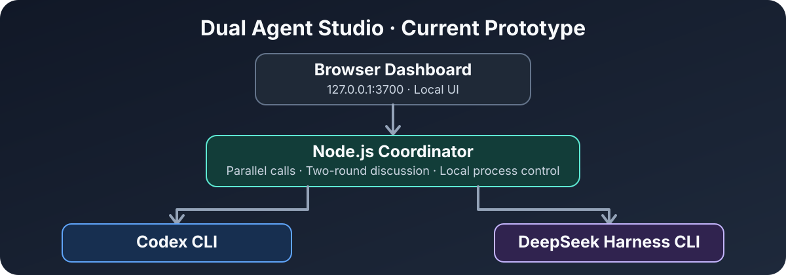

# Dual Agent Studio 🤖

**Two AI coding agents, one local workspace — discuss before they build.**

[简体中文](README_CN.md) · [Architecture](docs/ARCHITECTURE.md) · [Roadmap](docs/ROADMAP.md) · [Security](SECURITY.md)

> **Status: v0.1.1 prototype / early development.** The current app is a **local browser dashboard + Node.js coordinator**, **not yet an Electron desktop IDE**. The upcoming desktop application is a design goal, not a shipped feature.



Dual Agent Studio experiments with a straightforward idea: connect **OpenAI Codex CLI** and **DeepSeek Harness CLI** to a local coordinator so they can analyze a question in parallel and exchange perspectives. Both tools must be installed separately and authenticated with their own providers.

## What works today

| Capability | Status |
| --- | --- |
| HTTP dashboard bound to `127.0.0.1:3700` | Implemented; local smoke-tested |
| Detect `codex` / `dsh` commands in Windows PATH | Implemented; command presence only |
| Parallel one-shot answers | Implemented; **end-to-end agent calls not independently verified** |
| Two-round opinion exchange | Implemented; **end-to-end agent calls not independently verified** |
| Windows single-executable (Node SEA) build script | Included; **Windows EXE not independently built/tested here** |
| Persistent SDK sessions and streaming | Planned |
| Electron/React desktop window | Planned |
| Autonomous file edits, Git worktrees, task routing | Planned — **not supported** |

**Read-only is a best-effort prototype setting**, not a proven sandbox security boundary. Do not point the current version at sensitive repositories or secrets. See [SECURITY.md](SECURITY.md).

## Quick start — Windows

Prerequisites: **Node.js 25.5+ for building the EXE** (Node.js 26 recommended), Codex CLI and DeepSeek Harness CLI on PATH, and provider authentication for live calls. For source-only development, recent Node.js releases supporting ES modules and `node:sea` will work; CI uses Node.js 26.

```powershell
# From the repository root:
node --version
codex --version
dsh --version
node server.js
```

Open **http://127.0.0.1:3700**. The HTTP server runs locally, but the agents may contact their providers' online model services. No API keys are bundled in this repository.

You can also run `npm.cmd start` in PowerShell. (`npm.cmd` avoids a common Windows PowerShell `.ps1` execution-policy error.)

### Build the legacy standalone EXE

On **Windows x64 with Node.js 25.5+**, double-click `build.cmd` or run:

```powershell
node --build-sea sea-config.json
```

Expected output: `dist\DualAgentStudio.exe`. This **legacy executable starts the local HTTP server and opens the browser**; it is *not* a self-contained desktop UI. It does **not** embed Codex or DeepSeek. Build results and CLI behavior require validation on an actual Windows machine.

## Development & tests

```powershell
npm.cmd test
npm.cmd run check
```

The automated smoke tests start only the local coordinator with an isolated temporary port. **They do not call models, spend credits, or modify repositories.**

## How discussions work

1. The user submits one technical question.
2. In **Parallel**, both CLIs receive the same task in separate one-shot invocations.
3. In **Discuss**, each receives the other agent's previous answer and gets one additional response round.
4. The UI displays both results or explicit CLI failures. The app does not merge code or write to projects.

The current coordinator is not a full agent-to-agent message broker. There is no shared conversation memory between invocations or guaranteed agreement.

## Project direction

The next milestone is an **Electron + React + TypeScript Windows desktop app** that privately manages child processes and uses stdio/SDK adapters instead of fresh shell invocations. The long-term vision adds supervised code editing, Git worktrees, code review, and task orchestration. See [roadmap](docs/ROADMAP.md).

## Contributing

Bug reports, interface ideas, English/Chinese documentation, integration testing, and pull requests are welcome. Read [CONTRIBUTING.md](CONTRIBUTING.md). Do not submit credentials or private repository data.

## License

MIT — see [LICENSE](LICENSE). **Before publishing a binary release:** audit dependencies and implementation, verify the Windows build, and validate release artifacts.

This project is independent and is **not affiliated with, endorsed by, or an official product of OpenAI or DeepSeek**. Codex and DeepSeek names belong to their respective owners.
