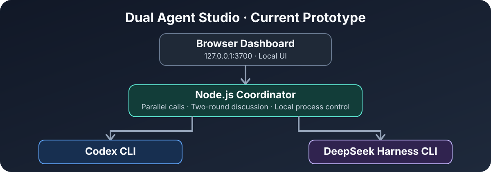

# Dual Agent Studio 🤖

**两个 AI 编程 Agent，一个本地协作空间——先讨论，再开发。**

[English](README.md) · [架构说明](docs/ARCHITECTURE.md) · [开发路线](docs/ROADMAP.md) · [安全说明](SECURITY.md)

> **当前状态：v0.1.1 早期原型。** 现有程序由 **Node.js 本地协调器 + 浏览器控制台** 组成，**还不是 Electron 桌面 IDE**。独立窗口、持续会话与自动开发功能属于后续规划。



Dual Agent Studio 希望让 **Codex CLI** 与 **DeepSeek Harness CLI** 在本机同时处理同一个技术问题，并交换意见。两种 CLI 都需要用户自行安装和配置账号；本项目不包含模型或账号凭据。

## 当前功能及完成情况

| 功能 | 状态 |
| --- | --- |
| 仅监听 `127.0.0.1:3700` 的本地服务和网页 UI | 已实现，已做本地基础测试 |
| 检查 Windows PATH 中 `codex` / `dsh` 是否存在 | 已实现；不代表登录或额度正常 |
| 两个 CLI 并行回答 | 已实现调用逻辑；**未独立验证真实双 Agent 调用** |
| 最多两轮互相交换观点 | 已实现调用逻辑；**未独立验证真实双 Agent 调用** |
| Windows Node SEA EXE 构建脚本 | 已提供；**尚未在 Windows 完成独立构建验证** |
| 持续 SDK 会话、实时输出 | 规划中 |
| Electron + React 桌面窗口 | 规划中 |
| 自动编辑项目、Git worktree、智能任务调度 | 规划中，**当前不支持** |

**当前“只读”是原型的参数与提示约束，并非已经过安全审计的沙箱。** 暂时不要把它接入含有隐私数据、密钥或敏感文件的真实工程。详见 [安全说明](SECURITY.md)。

## Windows 快速运行

需要安装：Node.js、Codex CLI、DeepSeek Harness CLI；真实对话还需要两个 Agent 各自的账号/模型服务可用。**生成 EXE 需要 Node.js 25.5+，推荐 Node.js 26。**

在项目根目录打开 PowerShell：

```powershell
node --version
codex --version
dsh --version
node server.js
```

然后访问 **http://127.0.0.1:3700**。

也可以运行 `npm.cmd start`。若 PowerShell 提示禁止执行 `npm.ps1`，使用 `npm.cmd` 即可，不需要降低系统安全策略。

### 构建旧版独立 EXE

在 Windows x64、Node.js 25.5+ 环境中双击 `build.cmd`，或运行：

```powershell
node --build-sea sea-config.json
```

预期输出为 `dist\DualAgentStudio.exe`。这个 EXE **仍会启动本地 HTTP 服务并打开外部浏览器**，不等于未来的 Electron 完整桌面软件；也不包含 Codex / DeepSeek 本体。真实 Windows 构建与 Agent 调用仍待验证。

## 不消耗模型额度的测试

```powershell
npm.cmd test
npm.cmd run check
```

测试只会在随机临时端口启动本地服务，检查网页、健康检查和请求安全边界。**不会调用模型，不会消耗 Codex 或 DeepSeek 额度。**

## 当前讨论逻辑

1. 用户输入一个技术任务。
2. 「同时回答」：两个 CLI 各自接收同一问题。
3. 「互相讨论两轮」：第一轮独立回答，第二轮读取对方观点并继续讨论。
4. 页面展示结果或失败信息；当前不会写入你的游戏工程，也不负责合并代码。

每次 CLI 调用都是独立进程，**还不具有跨轮持久记忆、实时流式事件或真正的任务协作管理**。

## 后续目标

我们计划将程序重构为 **Electron + React + TypeScript** 的 Windows 桌面软件：不再依赖外部浏览器或可见 PowerShell，通过内置进程管理器和 Agent 适配器管理服务。未来再加入持续会话、工作区隔离、代码审查、Git worktree 与人工审批。详情见 [开发路线](docs/ROADMAP.md)。

## 开源协作与许可

欢迎提交 Issue、文档改进和 Pull Request；贡献前请先阅读 [CONTRIBUTING.md](CONTRIBUTING.md) 和 [SECURITY.md](SECURITY.md)。

项目采用 **MIT 许可证**，见 [LICENSE](LICENSE)。发布二进制发行版前，还需检查第三方依赖、验证 Windows 构建并核对发行产物。

本项目为独立社区项目，**与 OpenAI、DeepSeek 无官方隶属、背书或合作关系**；相关名称与商标归各自所有者。
